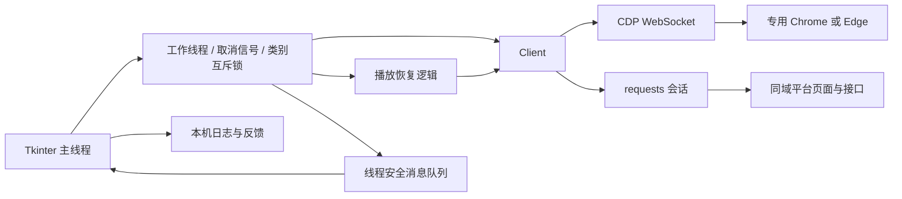
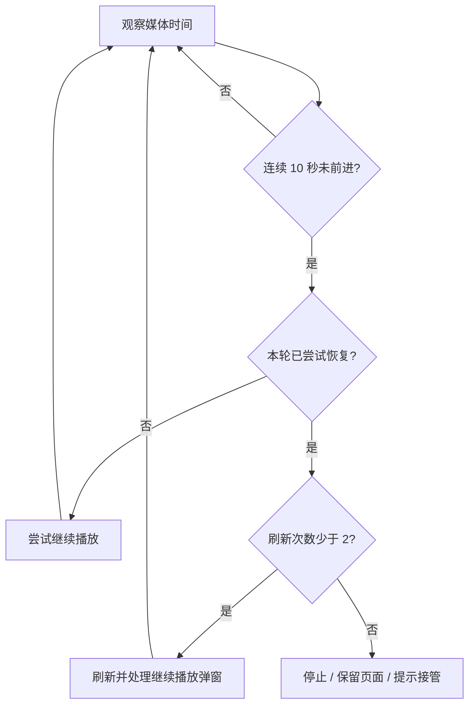

# Architecture / 架构与设计取舍

## 数据流

`app.py` 管理交互与生命周期，`core.py` 聚合连接、页面解析和业务判断，`playback.py` 管理正常播放。结构适合小型工具；`core.py` 仍有多种职责，并非已完成插件化分层。

程序从专用资料目录的 `DevToolsActivePort` 发现端口，将浏览器当前站点 Cookie 同步到内存 HTTP 会话。HTML 解析借助 Chromium `DOMParser`，因此仍依赖浏览器和网站结构。

## 生命周期

1. UI 锁定类别与模式，启动工作线程。
2. 获取类别级 Windows 命名互斥锁，防止同类任务多实例并发。
3. 连接浏览器，等待本人登录或选期，从页面识别课程和资源参数。
4. 限制同域、类别与资源身份，执行所选任务，通过队列回传日志。
5. 保存正常结果或显示异常，释放连接和锁，恢复按钮。

停止采用 `threading.Event` 协作取消；已发出的同步请求仍要等待返回或超时，不是瞬时中断。程序释放 CDP 连接，不关闭用户浏览器。

## 有限恢复

`StallGuard.observe(media_time, now)` 显式接收时间，可用虚拟时钟测试。媒体推进重置卡顿计时；刷新预算属于当前资源，不因短暂恢复而无限补充。外层每约 2 秒采样，“10 秒”是阈值，不是实时响应承诺。

外层每约 4 秒检查已知继续弹窗和暂停状态，必要时调用 `video.play()`，不增加第二套原生控制条、不改倍速或播放位置。

## 动作成功与业务完成

| 信号 | 含义 | 处理 |
| --- | --- | --- |
| 播放器 ended | 媒体结束 | 读取正式状态 |
| 接口返回成功 | 请求受理 | 读取正式状态 |
| 正式课程已完成 | 当前读取时平台记录完成 | 计入完成并跳过重复操作 |
| 正式状态无法识别 | 无法确认结果 | 标记待官网确认 |
| 正式状态仍未完成 | 动作未形成预期结果 | 停止并提示检查 |

POST 超时可能发生在服务端写入后，因此不盲目重复提交，重新运行前先读状态。没有服务端幂等键，不能称为严格 exactly-once 或分布式幂等系统。

## 内容匹配

以题型和规范化题干找候选；比较完整选项内容，再映射当前页面 ID，不依赖字母位置。重复选项、答案冲突与部分填空歧义返回未知。没有大模型生成答案，也没有测得总体准确率；演示使用中性合成题展示结构化匹配。

## 边界与后续工作

- 特定站点适配，不保证所有账户和培训期兼容；朋友电脑的积极分子问题缺少日志，回退不能视作已证实修复。
- CDP 串行调用，没有通用事件分发或多会话并发；互斥锁按类别隔离，不是按账号或跨电脑锁。
- Windows 为主要目标，没有跨平台桌面支持承诺。
- 正常播放和直接记录是两条路径；发展对象默认保留直接记录，不能描述成仅正常播放或只读工具。
- 不含 C/C++ 固件、FreeRTOS、硬件驱动或无线协议栈。Python 线程与队列不等于 RTOS 任务和中断安全机制。
- 没有线上可用率、并发量、节省工时或匹配准确率数据。

未来可分离 `core.py` 的协议、页面适配和业务职责，补页面变体与干净 Windows 环境验收。以上不计入已完成成果。
